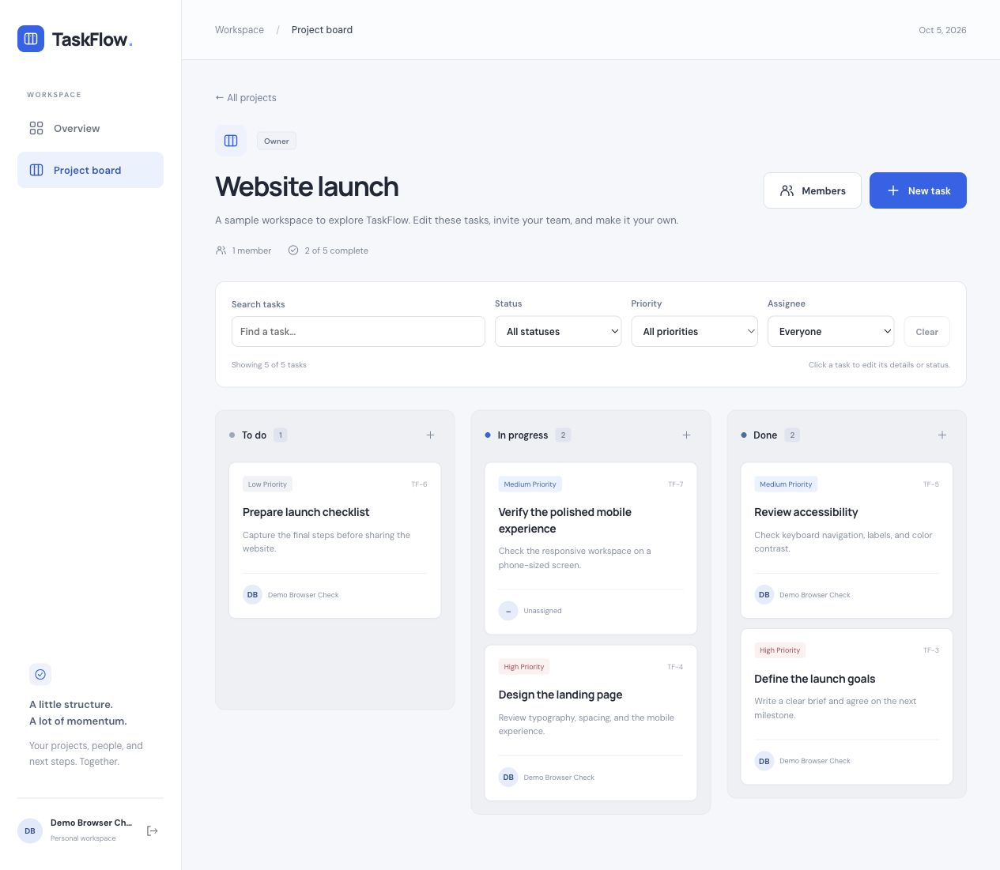
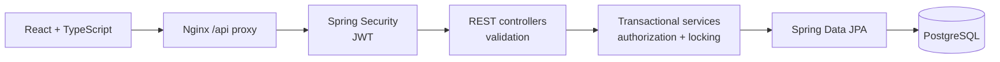
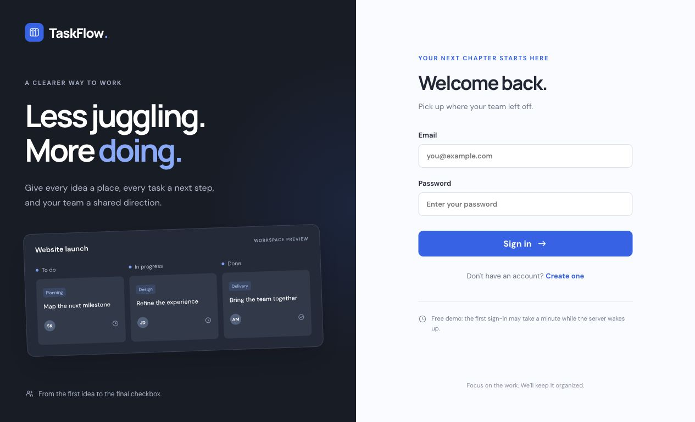
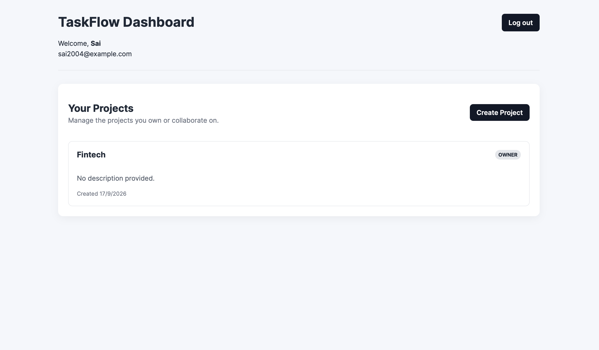

# TaskFlow

[](https://github.com/SaiSumedh18/taskflow/actions/workflows/ci.yml)

A team task manager with projects, members, and a Kanban board. The backend is **Java 21 + Spring Boot**. The focus is on **authorization that stays correct under concurrent changes**: who can see a project, who can edit it, and what happens when someone is removed.

**Live demo:** https://sai-taskflow-demo.onrender.com (free hosting, so the backend can take about a minute to wake up). Sign up with any email.



## Engineering highlights

- **Access is checked on every request, not just at login.** A removed member loses access immediately, even if their JWT is still valid, because membership is re-checked in the service layer.
- **Removing a member is atomic.** Their task assignments are cleared in the same transaction, so a task never points to someone who is no longer on the project.
- **Row locks prevent race conditions.** Membership and task changes take a lock on the project row, and task updates also lock the task row. Two people editing the same task can't overwrite unrelated fields.
- **Clear roles.** Only the OWNER manages members. Any member can create, edit, and delete tasks.
- **Safe migration from Node.js.** The Spring backend is a drop-in replacement for the original Express API: same endpoints, same database schema, and it accepts existing password hashes (and existing tokens if the JWT secret is 32+ bytes). The Node version is kept in `server/` as a fallback.
- **Careful input handling.** Bean validation on all requests, and passwords limited to 72 bytes so BCrypt never silently truncates them.

## Architecture



## Results

Local k6 test with 5,000 tasks and 5 concurrent users for 30 seconds:

| Operation | p50 | p95 | Requests/sec |
|---|---:|---:|---:|
| Load all 5,000 tasks | 54.4 ms | 142.8 ms | 76 |
| Filter (TODO + HIGH) | 7.8 ms | 21.2 ms | 498 |
| Move a card (status update) | 3.3 ms | 14.6 ms | 937 |

This was measured on a laptop, not in production. Method and raw output: [engineering notes](docs/ENGINEERING_NOTES.md#verified-benchmark-5000-synthetic-persisted-tasks).

## Tech stack

| Area | Tools |
|---|---|
| Frontend | React, TypeScript, Vite |
| Backend | Java 21, Spring Boot 3.5, Spring Security (JWT), Spring Data JPA / Hibernate |
| Database | PostgreSQL |
| Testing | JUnit 5, MockMvc against real PostgreSQL, k6 |
| Delivery | Docker Compose, Nginx, GitHub Actions, Spotless (google-java-format) |

## Run it locally

Requires Docker.

```bash
git clone https://github.com/SaiSumedh18/taskflow.git
cd taskflow
cp .env.example .env        # set JWT_SECRET to 32+ characters, e.g. `openssl rand -hex 32`
docker compose up -d --build
```

Open http://localhost:5173. The API is on port 4000.

To run the Spring service without Docker, roll back to the Node backend, or run the tests, see the [engineering notes](docs/ENGINEERING_NOTES.md#run-verify-rollback) and the [development guide](docs/DEVELOPMENT.md).

## Tests and CI

- 31 JUnit / MockMvc integration tests against real PostgreSQL, covering auth, roles, cross-project access, member removal, concurrent updates, and validation.
- The original Node backend's 7 tests still pass.
- GitHub Actions runs Java tests, formatting checks, packaging, frontend lint and build, and Docker image builds.

## Known limits and next steps

- The task list returns every task in a project. Pagination is next.
- No refresh tokens or token revocation list (removed members are blocked by the membership check instead).
- Next: drag-and-drop cards, activity history, real-time updates.

## More screenshots

| Sign in | Dashboard |
|---|---|
|  |  |

---

Built by **Sai Sumedh Kaveti** · [Portfolio](https://saisumedhkaveti.work/) · [LinkedIn](https://www.linkedin.com/in/saisumedhkaveti/)
