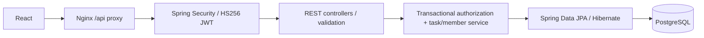

# TaskFlow — engineering notes

## Java 21 / Spring backend design

The default Compose backend is now `spring-server/`: Spring Boot 3.5.16, Spring Security JWT resource server, BCrypt, Spring Data JPA/Hibernate, PostgreSQL, Jakarta validation and JUnit 5/MockMvc. The working Node implementation remains in `server/`; `docker-compose.node.yml` preserves its rollback configuration. Original databases were not migrated or modified during verification.

Existing `/api/auth`, projects, memberships and task endpoints retain camelCase inputs and snake_case outputs, including role, creator/assignee names, and timestamps. React UX remains intact. Backend filtering supports status/priority and literal case-insensitive `search`. Project creation and OWNER membership are atomic. Project-row locks serialize membership/task mutations, and task-row locks protect updates; removing a member atomically clears assignments. Only OWNER can manage memberships. Any current member can create/update/delete tasks, matching the original behavior. Removed members lose access despite retaining a valid token.

### Run, verify, rollback

- Install Java **21** and Maven 3.9+. In `spring-server`, set JDBC_URL (for example `jdbc:postgresql://localhost:5433/taskflow`), DB_USER, DB_PASSWORD, JWT_SECRET (at least 32 UTF-8 bytes), CLIENT_URL, and optional PORT (4000). Run `mvn spring-boot:run`.
- Schema stays compatible with the original SQL. Production defaults to Hibernate validation and no automatic schema creation. Initialize a new empty database using `server/sql/schema.sql`, or set DB_INIT=always only for local initialization. Never enable destructive Hibernate schema modes on live databases.
- JWT expiry defaults to 7 days; configure JWT_EXPIRES_SECONDS. Existing Node HS256 tokens with `userId` work if the same sufficiently long secret is used; shorter secrets require rotation and sign-in again. BCrypt $2b$ hashes are supported. New passwords are limited to 72 UTF-8 bytes to avoid silent truncation.
- `docker compose -f docker-compose.yml up -d --build` uses Spring. Set VITE_API_URL=/api for the new frontend proxy and CLIENT_URL to the frontend origin. Review existing .env values; .env was preserved, not overwritten.
- Roll back with `docker compose -f docker-compose.node.yml up -d --build`. Keep the same database and JWT secret where compatible. The Node files remain functional.
- Isolated Docker verification: `docker compose -p taskflow-upgrade-verify -f compose.spring.verify.yml up -d --build --wait` (React 8092/API 4194/PostgreSQL 5497). Run `mvn -B spotless:check verify` with TEST_JDBC_URL=`jdbc:postgresql://localhost:5497/taskflow_test`, TEST_DB_USER=taskflow and TEST_DB_PASSWORD=local-test-only. Tests refuse any database other than `taskflow_test` and clear it.
- Backend format check: Spotless/google-java-format. Frontend: npm ci, npm run lint, npm run build. CI retains the legacy Node checks and adds Java 21 Spring tests/package/format and Docker image build. [GitHub Actions passed](https://github.com/SaiSumedh18/taskflow/actions/runs/37158076864) for the implementation commit.

### Verified benchmark: 5,000 synthetic persisted tasks

| Operation | Concurrent VUs | p50 ms | p95 ms | Requests/sec | HTTP error rate |
|---|---:|---:|---:|---:|---:|
| Full 5,000-task retrieval | 5 | 54.447 | 142.8454 | 75.55 | 0% |
| TODO + HIGH filter | 5 | 7.847 | 21.1878 | 498.33 | 0% |
| Kanban status update | 5 | 3.3035 | 14.6235 | 936.70 | 0% |

Method: Java 21.0.12.1, Spring Boot 3.5.16, native PostgreSQL 16.3 in a separate `taskflow_benchmark` database, macOS arm64, k6 2.3.0. `benchmarks/seed.sql` refuses non-benchmark databases and seeds one user/project/owner plus 5,000 tasks. Each sequential run uses five constant VUs for 30 seconds without think time, at localhost port 4195 (final update run: 4196). Before each run, 20 GET requests warm the JVM/query path (the update run warms GET, not PATCH). Full retrieval returns all records; filtered retrieval uses status=TODO&priority=HIGH (~833 tasks); update repeatedly patches task 1 to IN_PROGRESS under project/task locks. The update endpoint was remeasured after fixing overlapping patches to preserve unrelated fields, with a fresh JVM and concurrent Docker build activity; full/filter routes were unchanged. All requests check status 200. JWT signing is local/synthetic and no token is committed. Raw k6 summaries are in `benchmarks/results`. These measurements use a concurrent workload and are not directly comparable to the older README numbers; no speedup is claimed.

Verified: 31/31 JUnit/MockMvc integration tests pass on Java 21 against PostgreSQL, including a final Docker-backed database run; original Node tests pass 7/7 in a separate database. Java package and formatting checks pass. Frontend lint/build pass. Spring/frontend Docker builds and isolated full Compose/API smoke pass.

Limitations: full-list API returns all tasks for compatibility; pagination is future work. No refresh-token/revocation service, audit log, cloud deployment, or cross-instance stress/failover testing is claimed. Use HTTPS, secret rotation, database backups and operational monitoring before production. JPA entities retain foreign-key IDs with database-enforced relationships; batched user lookup avoids per-task name queries.
